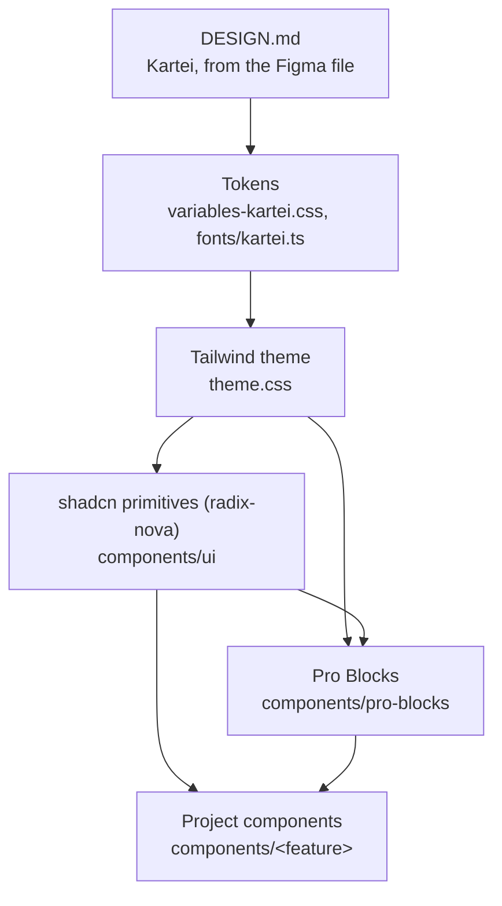

# About the architecture

How does a page of the Wissensstadt get from a text file to the visitor, and where does each part of that path live?

The site is a Next.js static export with no CMS and no server. Content is MDX in the repository; the build turns it into HTML files. Three accepted ADRs fix the shape of that path, and epic #23 builds it.

## From MDX to static HTML

```mermaid
flowchart LR
  mdx["MDX + frontmatter<br/>src/content"] --> loader["Loader<br/>Zod schema per content type"]
  meta["meta.json, Menus,<br/>site data"] --> loader
  loader --> graph["Content graph<br/>src/lib/content"]
  graph --> pages["Pages<br/>generateStaticParams"]
  graph --> chrome["Menus, breadcrumbs,<br/>previous/next"]
  graph --> seo["Metadata,<br/>sitemap.xml"]
  pages --> out["next build<br/>out/"]
  chrome --> out
  seo --> out
```

- The loader is our own code ([ADR-0002](../adr/adr-0002-own-content-loader-with-next-mdx.md)). Every cross-document rule (references, numbering, order, locale fallback) has to live in our code anyway, so a content framework would only add a second model of the same content. `@next/mdx` compiles the MDX bodies.
- The content graph is the one place pages, Menus, metadata and the sitemap read from. Each fact about a Viertel is written once and derived everywhere else, which is the failure of the old site this design answers: Viertel facts were written in six places there.
- URLs come from one rule per content type in the graph ([ADR-0003](../adr/adr-0003-urls-from-content-graph-rules.md)), not from file paths. A Kapitel belongs to the Leitthema but is read inside its Viertel, so its URL follows the reader's walk, not the folder it is stored in.
- German pages have no URL prefix ([ADR-0001](../adr/adr-0001-unprefixed-default-locale-urls.md)). A static export can't detect a visitor's language, and German readers shouldn't carry `/de` for translations that don't exist yet.

Everything left of `out/` runs at build time. The browser gets HTML, CSS and the JavaScript of the few Client Components: theme switching now, reading state later. [Static export](../reference/react/static-export.md) lists what that rules out.

## The design system in layers



Each layer only knows the one above it. A primitive reads `bg-primary`, not Petrol's value, so a token change in `variables-kartei.css` reaches every component without touching one. Primitives and blocks are installed by the shadcn CLI and then owned by the repository: the icon swap and the Kartei rules in [Design tokens](../reference/css/design-tokens.md) apply to them like to any project component.

The style choice follows DESIGN.md: `radix-nova` installs 32px buttons and inputs and 24px small buttons, the control sizes the Kartei screens use.

## Where to go next

- [Folder structure](../reference/global/folder-structure.md)
- [Theme system](../reference/css/theme-system.md)
- [shadcn setup](../reference/components/shadcn-setup.md)
